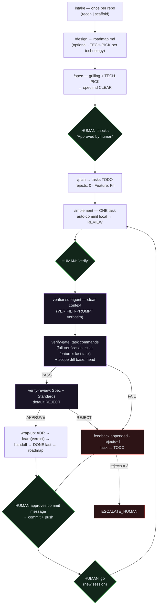
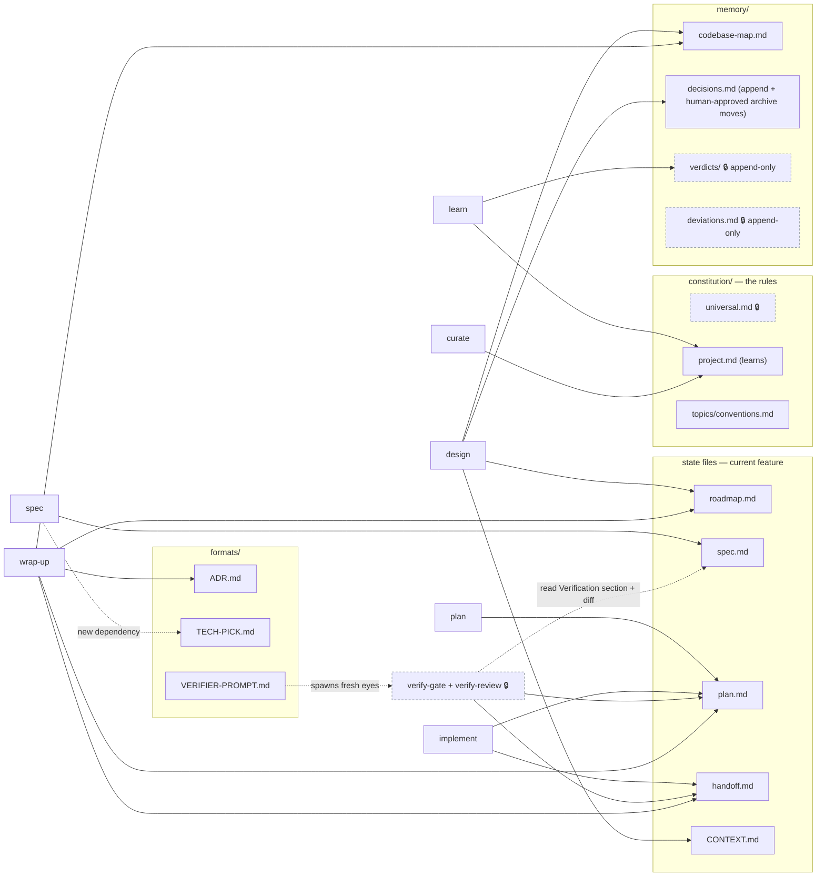

# Harness Architecture (v0.5)

How the harness itself works — the task lifecycle and the file map. View these
**rendered** (VS Code Mermaid preview, GitHub, or mermaid.live), not as raw text.
This describes the harness, not your project — your project's architecture lives
in `memory/codebase-map.md`.

## Task lifecycle

Green = human touchpoint · purple = clean-context verifier · red = reject path.
The diagram shows **Mode 1** (fully supervised). At Modes 2–4 the same graph
runs, but the green "verify" / "go" / commit-message nodes are passed without
waiting — the human touchpoints compress to spec approval, escalations, and
the feature-end checkpoint. The gates never change; who pushes between them
does. (The mode contract lives in `constitution/universal.md`.)

## File map — who writes what

🔒 = protected (`protected.txt`): human-only, except the append-only paths
(verdicts/, deviations.md) where the agent may add new entries but never
modify existing ones.
