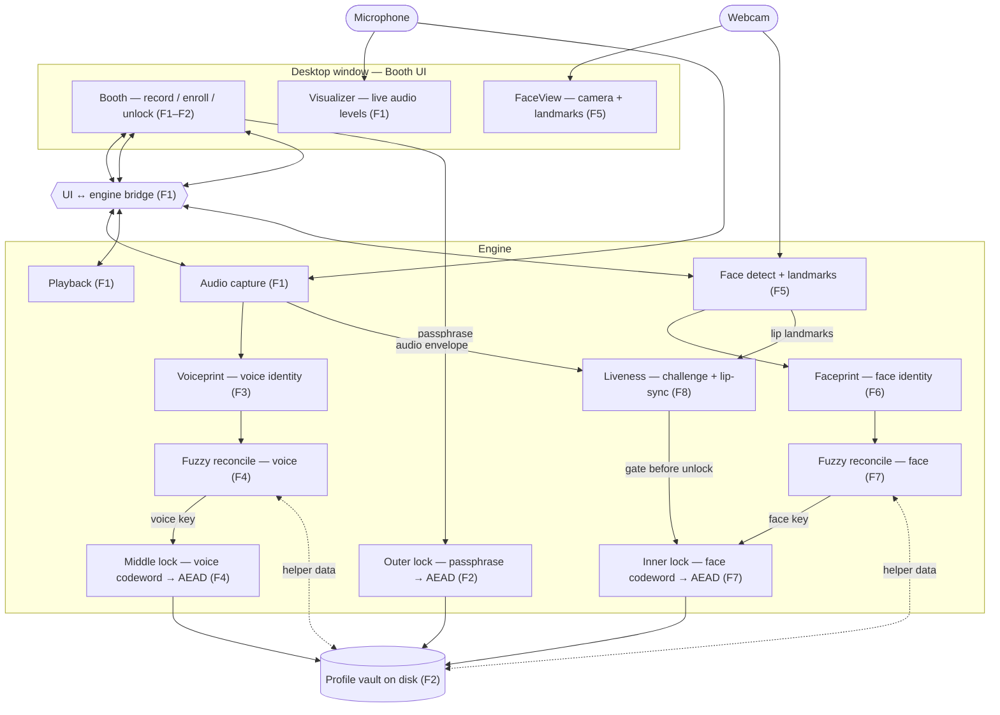

# Codebase Map — VoiceLock

A light, human-readable map so a fresh session can navigate without re-reading
everything. It is **not** a second source of truth — the code is the truth.
Regenerate it when it drifts.

- Updated: 2026-07-28 after **F8**. Solid = built (F1 booth + F2 outer lock +
  F3 voiceprint diagnostic + F4 voice middle lock + F5 camera booth + F6
  faceprint diagnostic + F7 face inner lock + **F8 lip-sync liveness**);
  dashed = planned (F9). **F8 adds a liveness GATE, not a fourth lock:**
  `challenge.py` (new, Vosk grammar-constrained challenge-word match) and
  `lipsync.py` (new, lag-windowed cross-correlation of mouth-aperture vs
  audio envelope) are two independent signal modules; `app.py`'s `unlock()`
  runs both — via `_liveness_passes()` — BEFORE any call into
  `vault_unlock()`, so a failed liveness attempt makes zero calls into the
  vault layer and learns nothing about whether voice/face would have
  matched (ADR 0005). `vault.py`/`middlelock.py`/`facelock.py`/
  `facedetect.py`/`capture.py` are all byte-for-byte unchanged — the whole
  feature lives in two new modules plus additive `app.py`/UI wiring.
  F4 made the voiceprint a real lock: a hand-rolled numpy code-offset fuzzy
  commitment turns it into a stable key, the vault became **two nested AEAD
  layers** (passphrase outer around voice middle), and the Booth showed two
  visibly distinct rejects. F3's match meter survives untouched as an
  independent diagnostic. F4.5 added no components — it fixed the capture
  callback's self-deadlock and gave the callback path real test coverage.
  **F5 gave the Booth an eye:** `facedetect.py` opens the webcam, runs the
  vendored MediaPipe Face Landmarker, composites an ellipse + landmarks onto
  each frame and pushes it to the page as a data URI, so **FaceView and
  FaceDetect are solid**. It computed no identity — that was F6. **F5.5
  added no components** — it deleted unreachable surface from
  `voiceprint.py` and made `load_wav` refuse bad audio instead of converting
  it. **F6 gave the Booth a face identity:** `faceprint.py` computes an
  SFace embedding via a hand-built MediaPipe→YuNet alignment and shows a
  live match meter beside the voiceprint one — the visual analog of F3. Not
  wired into any lock yet. **F7 makes the face a real lock, one layer
  deeper than F4:** `facelock.py` (new) ports `middlelock.py`'s fuzzy
  commitment for SFace's 128-dim embedding — variable-length enrollment
  (≥1 embedding, not a fixed count, so the same code path serves both a
  single-fixture Gate test and a 3-frame live burst) and a measured
  `CORRECTION_RADIUS = 95`. `vault.py` is now **three nested AEAD layers**
  (passphrase outer → voice middle → face inner), `FORMAT_VERSION = 3`,
  both v1 and v2 vaults refused by name. The Booth shows three visibly
  distinct rejects. **`faceprint.py` itself is untouched** — F7 only
  consumes `embed_frame`/`embed_file`; F6's diagnostic panel stays an
  independent, non-lock meter exactly as F3's voiceprint panel did after
  F4.

## Architecture (data flow)

## Shape
- `.harness/` — governing harness (roadmap, specs, conventions).
- `design/` — mock UI reference (`voicelock-mock.html`); not final chrome.
- `src/voicelock/` — app engine (capture, playback, vault, pywebview host).
- `src/voicelock/ui/` — HTML/CSS/JS booth (offline).
- `tests/` — pytest suite (fake streams / temp vault paths; no real mic **or
  webcam** in Gate). `tests/test_capture.py`'s `FakeStream` delivers 2-D
  `(frames, channels)` through the **real** callback and raises a
  `BaseException` tripwire on re-entrant teardown (F4.5).
  `tests/test_facedetect.py`'s `FakeCamera` is that pattern translated to a
  **polling** device: `cv2.VideoCapture` has no callback, so `read()` is the
  real path the fake delivers through and `release()` is the teardown it trips
  on — `CameraUsedAfterRelease` is a `BaseException` subclass *and* sets a flag,
  because an exception raised in a daemon thread dies with that thread.
- `tests/fixtures/face/` — **`portrait.jpg` is NOT committed** (licence-
  restricted; `.gitignore`d) and must be fetched per that folder's `README.md`,
  or the real-model test skips and the Gate's presence check fails. Its
  Apache-2.0 vendor reference `portrait_expected_face_landmarks.pbtxt` **is**
  committed. This inverts the voiceprint fixtures, which are committed on
  purpose. **F6 adds three fixtures that ARE committed** (`personA_1.jpg`,
  `personA_2.jpg`, `personB.jpg` — Public domain/CC0, no redistriction
  restriction, unlike `portrait.jpg`): two independent photographs of
  Frederick Douglass (same person, genuinely different photographic acts —
  not a derived probe) plus the MET daguerreotype carried over from F5's
  research. `personA_2.jpg` is a resize-only JPEG derivative of an
  upstream TIFF (disclosed in the fixtures README).

## Key modules
- `src/voicelock/capture.py` — 16 kHz mono capture, levels, 30s soft cap, mic error.
  At the cap the PortAudio callback raises `sd.CallbackStop` and does **no**
  teardown (F4.5 — tearing down there deadlocks: `Pa_StopStream` blocks until the
  callback returns); `pump()`'s cap check does the teardown, and `app.py` polls it
  every 50 ms
- `src/voicelock/playback.py` — play / stop PCM buffers
- `src/voicelock/vault.py` — **v3 nested vault** (F7, one layer deeper than F4's
  v2): innermost profile JSON sealed with the face-derived **inner** key →
  `inner_ciphertext`; middle plaintext `{helper_data_face, inner_ciphertext}`
  sealed with the voice-derived **middle** key → `middle_ciphertext`; outer
  plaintext `{helper_data_voice, middle_ciphertext}` sealed with F2's
  passphrase key; `VLCK` + version byte 3. Peel order outer→middle→inner, so
  a wrong passphrase raises `AuthError` before the voice is consulted, and a
  wrong voice raises `VoiceAuthError` before the face is consulted;
  `FaceAuthError` is the new inner REJECT. `LegacyVaultError` refuses **both**
  a v1 vault ("predates voice") and a v2 vault ("predates face") — re-enroll,
  no bypass
- `src/voicelock/middlelock.py` — middle lock (F4): hand-rolled code-offset fuzzy
  commitment in pure numpy, no new dependency. `commit` / `reconcile` /
  `derive_key` / `residual_bits`; 4096-bit LSH pool masked to 512 reliable bits by
  cross-take unanimity, 32-bit secret repeated 16x, soft-decision decoding,
  `CORRECTION_RADIUS = 110` pinned from 200 measured commits
- `src/voicelock/facelock.py` — inner lock (F7): the same code-offset fuzzy
  commitment construction as `middlelock.py`, reparameterized for SFace's
  128-dim embedding (`EMBEDDING_DIM = 128`, pinned locally since
  `faceprint.py` exports no such constant). `CANDIDATE_BITS`/`RELIABLE_BITS`/
  `KEY_BITS`/`REPETITION` reused **unchanged** from `middlelock` (they size
  the ECC bit budget, not the embedding width). Two deliberate departures
  from `middlelock`: `commit()` takes a **variable-length**, non-empty
  embedding list (not a fixed count) — the reliability mask's cross-take-
  unanimity filter is vacuously true at n=1, its own documented fallback to
  pure margin ranking, so the same code serves both the Gate test's single
  fixture take and production's `ENROLLMENT_TAKES = 3` live burst; and
  `CORRECTION_RADIUS = 95` rests on thinner evidence (n=1 genuine/n=2
  impostor over 100 fresh-LSH-seed trials against the real A1/A2/B fixtures,
  disclosed in the module docstring) than `middlelock`'s 200-commit
  measurement
- `src/voicelock/voiceprint.py` — offline ECAPA speaker embedding (F3): `embed`,
  `set_reference` (3-take L2-avg, injectable path), `cosine_distance`, `compare`
  → (distance, band) with pinned `ACCEPT/REJECT_CUTOFF`. **F5.5:** everything
  here assumes 16 kHz mono and nothing converts — `load_wav` **raises**
  `ValueError` naming the real rate / channel count, and `embed`/`compare` take
  no `sample_rate`. That is correct only because `capture.py` pins the mic;
  **a source without such a pin must convert, not refuse** (the comment beside
  the raises says so, and a Gate command keeps it there)
- `src/voicelock/models/ecapa/` — vendored SpeechBrain ECAPA (Apache-2.0), loaded
  offline (`HF_HUB_OFFLINE`, `pretrained_path` override + `LocalStrategy.NO_LINK`)
- `src/voicelock/facedetect.py` — webcam + face landmarks (F5): `process_frame`
  is the per-frame composite (detect on the FULL 640×480 frame → ellipse + eye
  and **lip** points → centre-crop → 172 px → **`cv2.flip` LAST**, so the
  overlay flips with the pixels and **no landmark coordinate is ever mirrored**)
  → JPEG → base64 data URI. `start`/`stop` run a daemon worker at
  `TARGET_FPS = 30` with **halt → join → release** ordering and
  drop-don't-queue pacing (`pacing_delay`). `FrameResult.landmarks` carries
  **all 478**, unflipped, for F8. Injectable `open_camera` + `landmarker`, so
  no Gate test touches a webcam. ~10 ms/frame measured. **F6 added:**
  `FaceEngine.last_frame`, the raw pre-overlay frame each `_loop` tick, set
  additively with no change to the crop/mirror/overlay order or the
  halt→join→release sequence — `faceprint.py`'s on-demand embed reads this,
  never the composited/JPEG'd `data_uri`.
- `src/voicelock/models/face_landmarker/` — vendored MediaPipe Face Landmarker
  (Apache-2.0, with `LICENSE` + `NOTICE` recording the evidence chain), loaded
  from a local path via `model_asset_path`; **`VIDEO` running mode**, so the
  engine owns a monotonic timestamp counter. Note: a `VIDEO`-mode instance
  carries face-tracker state across calls — reusing one across UNRELATED
  still images (not real consecutive frames) can silently drop the face on
  the 2nd/3rd image with no error (F6 Task 2 finding).
- `src/voicelock/faceprint.py` — offline SFace face embedding (F6): a
  **second**, `IMAGE`-mode `FaceLandmarker` instance (module-cached, not
  shared with `facedetect.py`'s `VIDEO`-mode one — `IMAGE` mode is
  stateless per call, so it does not hit the tracker-state hazard above) is
  used only to build a 5-point YuNet-shaped alignment row (eye centres =
  midpoint of 33+133 / 263+362, nose = 4, mouth = 61/291) fed through
  `cv2.FaceRecognizerSF.alignCrop` + `.feature()`. `embed_frame` / `embed_file`
  (raises `NoFaceError`) / `compare` (raw L2, via `FaceRecognizerSF.match`) /
  `band_for` / `set_reference` (3-frame average) / `load_reference` (raises
  `NoReferenceError`) / `default_reference_path()` →
  `~/.voicelock/faceprint.ref`. `ACCEPT_CUTOFF == REJECT_CUTOFF == 1.128`
  (L2) — OpenCV's one published SFace operating point in two metrics is the
  same boundary, not two independent bars, so the borderline band has zero
  width by design (2026-07-27 decision, `memory/decisions.md`). Several
  faces in frame → largest by landmark bounding-box area wins, never the
  first. **Converts, never refuses** — the opposite of `voiceprint.py`'s
  `load_wav`, and the module docstring says why (a camera has no format pin
  the way `capture.py` pins the mic).
- `src/voicelock/models/sface/` — vendored OpenCV SFace ONNX (Apache-2.0,
  `LICENSE` + `NOTICE`; licence established from opencv_zoo's own
  per-directory README statement naming the exact `.onnx` file, a stronger
  chain than `face_landmarker`'s three-model-card corroboration)
- `src/voicelock/challenge.py` — challenge-word liveness signal (F8):
  `CHALLENGE_PHRASES` (12 hand-authored short sentences, own words),
  `pick_challenge(previous, rng)` (no-immediate-repeat, injectable `rng`),
  `matches()` (pure text compare — lowercase + strip punctuation, no model
  load), `check(audio, challenge, decoys)` (Vosk grammar-constrained
  `KaldiRecognizer` decode against `challenge` + the rest of the pool as
  decoys + `[unk]`, returns `matches()` on the recognized text). Model
  loaded once, module-cached, `vosk.SetLogLevel(-1)` silences Kaldi's
  default stderr chatter.
- `src/voicelock/models/vosk/` — vendored `vosk-model-small-en-us-0.15`
  (Apache-2.0, established from the distribution page's own per-model
  table — the archive itself carries no licence text), loaded fully
  offline from a local path.
- `src/voicelock/lipsync.py` — lip-sync liveness signal (F8):
  `mouth_aperture(landmarks)` (normalized inner-lip vertical gap — indices
  13/14, confirmed against the vendored bundle's own topology — divided by
  inter-eye distance, reusing `faceprint.py`'s eye-corner indices),
  `score(mouth_series, audio_envelope, lag_window)` (peak Pearson
  correlation over `[-LAG_WINDOW, +LAG_WINDOW]`, compares over the shorter
  length if the two arrays differ), `is_live(score)` (`score >=
  SYNC_THRESHOLD`). `LAG_WINDOW = 5`, `SYNC_THRESHOLD = 0.5` — dry-run
  measured from a real audio envelope + synthetic mouth series (module
  docstring discloses this is synthetic-only, not real human lip-sync
  data). Pure numpy, no new dependency.
- `src/voicelock/app.py` — pywebview host + JS bridge. **F5 added:** an
  injectable `face` engine; `start_record` starts the camera (after capture, so
  a broken webcam never costs the take) and `stop_record` stops it;
  `_pump_loop`'s capture-ended branch **also** stops it, because F4.5's 30 s cap
  ends a take with nobody pressing Stop; and `shutdown()` — wired to
  `window.events.closing` — releases it on window close. (`BoothApi`
  record/enroll/unlock + F3 `set_reference`/`compare`/`reset_reference` + F4
  `enroll_take`/`reset_enroll_takes` and `lock_voiceprint()`, which enforces the
  raised `MIN_LOCK_SECONDS` floor and window-averages each lock take.)
  **F6 added:** `set_face_reference`/`compare_face`/`reset_face_reference`,
  reading `face.last_frame`. `compare_face` checks the stored reference
  first (cheap, mirrors `voiceprint.compare`'s ordering) before embedding
  the live frame; called on a low fixed interval from JS, never from inside
  the 30 fps preview loop. **F7 added:** `enroll_face_take`/
  `reset_enroll_face_takes` (mirroring the F4 voice pair exactly, feeding
  only `facelock.commit` via `vault.enroll` — never `faceprint.ref`), a
  `need_face_takes` guard in `enroll()` after `need_voice_takes`, and
  `unlock()` now embeds `self.face.last_frame` and passes it through;
  `FaceAuthError` maps to `auth_face` alongside `auth_outer`/`auth_voice`.
  **F8 added:** `new_challenge()` (picks + stores `_current_challenge` via
  `challenge.pick_challenge`); `start_unlock_capture()`/
  `stop_unlock_capture()` — a THIRD Record/Stop pair, distinct from
  `start_record()`/`stop_record()` (enroll keeps using those unmodified),
  capped at `LIVENESS_CAPTURE_CEILING_SECONDS = 10.0` instead of
  `capture.MAX_SECONDS = 30.0`, arming `_retain_landmarks` so
  `_push_face_frame` additively feeds `_liveness_mouth_series`; the fixed-
  ceiling auto-stop path in `_pump_loop()` resets both fields too (it
  bypasses `stop_unlock_capture()` entirely — a real bug F8 Task 3 found
  and fixed, the third occurrence of the acquisition/release guardrail's
  own predicted failure shape). `unlock()`'s body: after computing the
  voice and face embeddings exactly as F7 left them, `_liveness_passes()`
  (`challenge.check()` AND `lipsync.is_live(lipsync.score(...))`, envelope
  from `_audio_envelope()` — fixed-hop RMS at `facedetect.FRAME_INTERVAL`)
  gates BEFORE `vault_unlock()` is ever called; `auth_liveness` is the new
  fifth reject reason.
- `src/voicelock/ui/index.html` — Booth chrome + Record/Stop/Play + Enroll/Unlock
  + F3 voiceprint panel (3-band meter, Set reference, Reset) + F4 enroll voice
  step (5 sentences, per-take dots) and two distinct reject chips
  ("Wrong passphrase" / "Voice didn't match") + F5 `setFaceFrame`/`setFaceIdle`,
  which swap an `` over the decorative smiley inside the existing 172 px
  `.face-wrap`. The page holds **no camera state** and does no cropping,
  scaling or mirroring — Python delivers a finished 172 px square. **F6
  added:** a `.faceprint`/`#faceprint-panel` block mirroring the voiceprint
  panel, polling `compare_face` on a 1 s `setInterval` gated on
  `recording && hasFaceReference` (never every frame), plus visible
  liveness-honesty copy ("matches a face — does not prove a live person").
  Page holds no face-match state — JS renders Python's distance/band only.
  **Also fixed a layout bug F6 introduced:** `main` no longer centers
  `.booth` via `justify-content: center` (which silently clips overflowing
  content past both edges, with `overflow-y: auto` unable to reach it) —
  `.booth` centers itself via `margin: auto 0` instead, which degrades to
  top-anchored + scrollable when content doesn't fit. **F7 added:**
  `#enroll-face-step` mirroring `#enroll-voice-step` (3-dot progress, hint,
  "Bank this frame" wired to `enroll_face_take`) inside `#enroll-panel`,
  gated by a new `refreshEnrollButton()` that requires BOTH the voice and
  face steps done before Enroll is clickable; a third reject chip
  (`chip-wrong-face` / `showWrongFace()`) wired on `auth_face`, alongside
  `showUnlockNoFace()` for the `no_face` edge at unlock. `.enroll-panel`
  sits inside `.profiles`, which is `overflow-y: auto` with default
  top-anchored flex (no `justify-content: center`) — structurally distinct
  from the `main`/`.booth` clipping hazard above. **F8 added:**
  `.challenge-display` (shown before Record, stays visible through the
  capture — Python is authoritative for the phrase via `new_challenge()`,
  called at Booth init and after every completed unlock attempt; JS never
  computes one); Record/Stop routed to `start_unlock_capture()`/
  `stop_unlock_capture()` only during an unlock attempt via
  `isUnlockCapture()` (passphrase-field-focus AND-ed with "enroll panel
  not open" — there is no separate "Unlock panel" toggle in this Booth's
  DOM, so intent is read from the signal that actually exists; decided
  once per Record press into `activeCaptureIsUnlock` and reused at Stop so
  a mid-take state change can't send Python a mismatched start/stop pair);
  a fifth reject chip (`chip-liveness-failed` / `showLivenessFailed()`)
  wired on `auth_liveness`, mirroring `showWrongFace()` exactly.
- `src/voicelock/__main__.py` — `python -m voicelock`

## Where things live
- Entry point(s): `uv run voicelock`
- Vault path: `~/.voicelock/vault.vl` (format **v3** since F7; v1 and v2 vaults are both refused with a re-enroll prompt naming the missing layer)
- Voiceprint reference: `~/.voicelock/voiceprint.ref` (F3, plaintext sibling, not the vault)
- Faceprint reference: `~/.voicelock/faceprint.ref` (F6, plaintext sibling, not the vault)
- Tests: `tests/` via `uv run pytest`
- Config: `pyproject.toml` + `uv.lock` (includes `pynacl`, `soundfile` since
  F4.5, and `vosk` since F8)
- Lint: `uv run ruff check .`

## Conventions
See `constitution/topics/conventions.md`.
