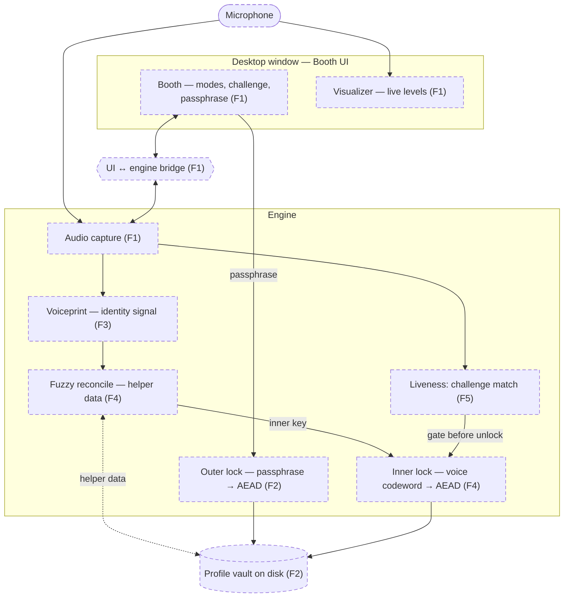

# Codebase Map — VoiceLock

A light, human-readable map so a fresh session can navigate without re-reading
everything. It is **not** a second source of truth — the code is the truth.
Regenerate it when it drifts.

- Greenfield: seeded by `design` (2026-07-22); layout locked by intake-scaffold
  (2026-07-22). **Dashed = planned, solid = built** — nothing built yet.

## Architecture (data flow)

Same boxes as `roadmap.md`.

## Shape
- `.harness/` — governing harness (roadmap, specs, conventions).
- `design/` — mock UI reference (`voicelock-mock.html`); not final chrome.
- `src/voicelock/` — app engine (planned; F1 creates it).
- `src/voicelock/ui/` — HTML/CSS/JS booth (planned; adapted from mock).
- `tests/` — pytest suite (planned; F1 creates it).

## Key modules
(None yet — greenfield. F1 creates the first.)

## Where things live
- Entry point(s): `uv run voicelock` (planned, F1)
- Tests: `tests/` via `uv run pytest`
- Config: `pyproject.toml` + `uv.lock` (planned, F1)
- Lint: `uv run ruff check .`

## Conventions
See `constitution/topics/conventions.md`.
