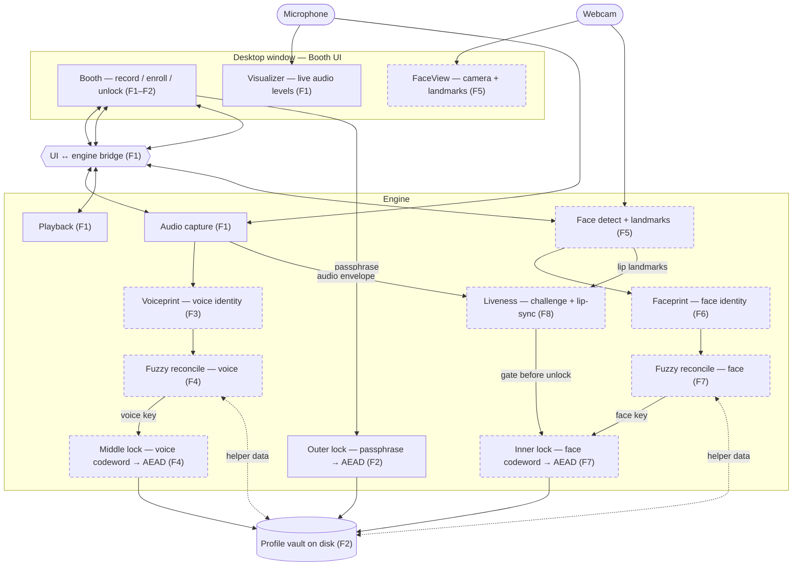

# Codebase Map — VoiceLock

A light, human-readable map so a fresh session can navigate without re-reading
everything. It is **not** a second source of truth — the code is the truth.
Regenerate it when it drifts.

- Updated: 2026-07-22 after F2, then re-scoped by `design` for the three-factor
  pivot (voice + face + lips). Solid = built (F1 booth + F2 outer lock);
  dashed = planned (F3–F9). Nothing below F2 exists in code yet.

## Architecture (data flow)

## Shape
- `.harness/` — governing harness (roadmap, specs, conventions).
- `design/` — mock UI reference (`voicelock-mock.html`); not final chrome.
- `src/voicelock/` — app engine (capture, playback, vault, pywebview host).
- `src/voicelock/ui/` — HTML/CSS/JS booth (offline).
- `tests/` — pytest suite (fake streams / temp vault paths; no real mic in Gate).

## Key modules
- `src/voicelock/capture.py` — 16 kHz mono capture, levels, 30s soft cap, mic error
- `src/voicelock/playback.py` — play / stop PCM buffers
- `src/voicelock/vault.py` — outer lock (Argon2id + SecretBox), VLCK file format
- `src/voicelock/app.py` — pywebview host + JS bridge (`BoothApi` record/enroll/unlock)
- `src/voicelock/ui/index.html` — Booth chrome + Record/Stop/Play + Enroll/Unlock
- `src/voicelock/__main__.py` — `python -m voicelock`

## Where things live
- Entry point(s): `uv run voicelock`
- Vault path: `~/.voicelock/vault.vl`
- Tests: `tests/` via `uv run pytest`
- Config: `pyproject.toml` + `uv.lock` (includes `pynacl`)
- Lint: `uv run ruff check .`

## Conventions
See `constitution/topics/conventions.md`.
