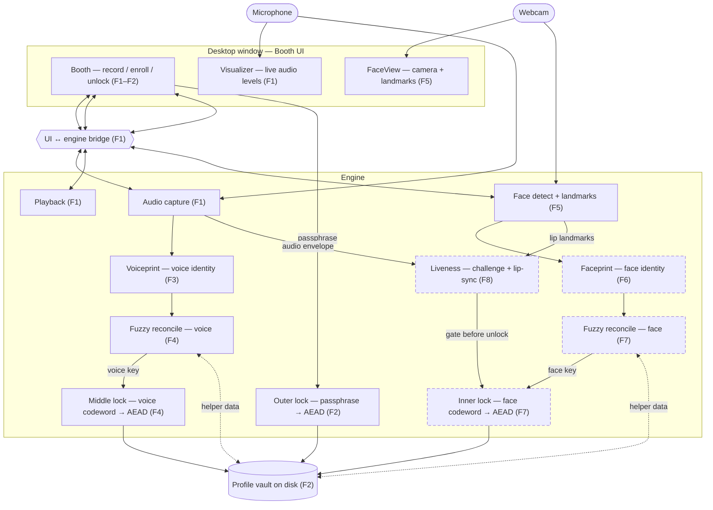

# Codebase Map — VoiceLock

A light, human-readable map so a fresh session can navigate without re-reading
everything. It is **not** a second source of truth — the code is the truth.
Regenerate it when it drifts.

- Updated: 2026-07-26 after **F5**. Solid = built (F1 booth + F2 outer lock + F3
  voiceprint diagnostic + F4 voice middle lock + **F5 camera booth**); dashed =
  planned (F6–F9). F4 made the voiceprint a real lock: a hand-rolled numpy
  code-offset fuzzy commitment turns it into a stable key, the vault is now
  **two nested AEAD layers** (passphrase outer around voice middle), and the
  Booth shows two visibly distinct rejects. F3's match meter survives untouched
  as an independent diagnostic. F4.5 added no components — it fixed the capture
  callback's self-deadlock and gave the callback path real test coverage.
  **F5 gave the Booth an eye:** `facedetect.py` opens the webcam, runs the
  vendored MediaPipe Face Landmarker, composites an ellipse + landmarks onto
  each frame and pushes it to the page as a data URI, so **FaceView and
  FaceDetect are now solid**. It computes **no identity** — that is F6.

## Architecture (data flow)

## Shape
- `.harness/` — governing harness (roadmap, specs, conventions).
- `design/` — mock UI reference (`voicelock-mock.html`); not final chrome.
- `src/voicelock/` — app engine (capture, playback, vault, pywebview host).
- `src/voicelock/ui/` — HTML/CSS/JS booth (offline).
- `tests/` — pytest suite (fake streams / temp vault paths; no real mic **or
  webcam** in Gate). `tests/test_capture.py`'s `FakeStream` delivers 2-D
  `(frames, channels)` through the **real** callback and raises a
  `BaseException` tripwire on re-entrant teardown (F4.5).
  `tests/test_facedetect.py`'s `FakeCamera` is that pattern translated to a
  **polling** device: `cv2.VideoCapture` has no callback, so `read()` is the
  real path the fake delivers through and `release()` is the teardown it trips
  on — `CameraUsedAfterRelease` is a `BaseException` subclass *and* sets a flag,
  because an exception raised in a daemon thread dies with that thread.
- `tests/fixtures/face/` — **`portrait.jpg` is NOT committed** (licence-
  restricted; `.gitignore`d) and must be fetched per that folder's `README.md`,
  or the real-model test skips and the Gate's presence check fails. Its
  Apache-2.0 vendor reference `portrait_expected_face_landmarks.pbtxt` **is**
  committed. This inverts the voiceprint fixtures, which are committed on
  purpose.

## Key modules
- `src/voicelock/capture.py` — 16 kHz mono capture, levels, 30s soft cap, mic error.
  At the cap the PortAudio callback raises `sd.CallbackStop` and does **no**
  teardown (F4.5 — tearing down there deadlocks: `Pa_StopStream` blocks until the
  callback returns); `pump()`'s cap check does the teardown, and `app.py` polls it
  every 50 ms
- `src/voicelock/playback.py` — play / stop PCM buffers
- `src/voicelock/vault.py` — **v2 nested vault** (F4): profile JSON sealed with the
  voice-derived middle key, wrapped in `{helper_data, middle_ciphertext}` sealed
  with F2's passphrase key; `VLCK` + version byte 2. Peel order outer→middle, so a
  wrong passphrase raises `AuthError` before the voice is consulted; `VoiceAuthError`
  is the middle REJECT and `LegacyVaultError` refuses a v1 vault (re-enroll, no
  passphrase-only bypass)
- `src/voicelock/middlelock.py` — middle lock (F4): hand-rolled code-offset fuzzy
  commitment in pure numpy, no new dependency. `commit` / `reconcile` /
  `derive_key` / `residual_bits`; 4096-bit LSH pool masked to 512 reliable bits by
  cross-take unanimity, 32-bit secret repeated 16x, soft-decision decoding,
  `CORRECTION_RADIUS = 110` pinned from 200 measured commits
- `src/voicelock/voiceprint.py` — offline ECAPA speaker embedding (F3): `embed`,
  `set_reference` (3-take L2-avg, injectable path), `cosine_distance`, `compare`
  → (distance, band) with pinned `ACCEPT/REJECT_CUTOFF`
- `src/voicelock/models/ecapa/` — vendored SpeechBrain ECAPA (Apache-2.0), loaded
  offline (`HF_HUB_OFFLINE`, `pretrained_path` override + `LocalStrategy.NO_LINK`)
- `src/voicelock/facedetect.py` — webcam + face landmarks (F5): `process_frame`
  is the per-frame composite (detect on the FULL 640×480 frame → ellipse + eye
  and **lip** points → centre-crop → 172 px → **`cv2.flip` LAST**, so the
  overlay flips with the pixels and **no landmark coordinate is ever mirrored**)
  → JPEG → base64 data URI. `start`/`stop` run a daemon worker at
  `TARGET_FPS = 30` with **halt → join → release** ordering and
  drop-don't-queue pacing (`pacing_delay`). `FrameResult.landmarks` carries
  **all 478**, unflipped, for F6/F8. Injectable `open_camera` + `landmarker`, so
  no Gate test touches a webcam. ~10 ms/frame measured
- `src/voicelock/models/face_landmarker/` — vendored MediaPipe Face Landmarker
  (Apache-2.0, with `LICENSE` + `NOTICE` recording the evidence chain), loaded
  from a local path via `model_asset_path`; **`VIDEO` running mode**, so the
  engine owns a monotonic timestamp counter
- `src/voicelock/app.py` — pywebview host + JS bridge. **F5 added:** an
  injectable `face` engine; `start_record` starts the camera (after capture, so
  a broken webcam never costs the take) and `stop_record` stops it;
  `_pump_loop`'s capture-ended branch **also** stops it, because F4.5's 30 s cap
  ends a take with nobody pressing Stop; and `shutdown()` — wired to
  `window.events.closing` — releases it on window close. (`BoothApi`
  record/enroll/unlock + F3 `set_reference`/`compare`/`reset_reference` + F4
  `enroll_take`/`reset_enroll_takes` and `lock_voiceprint()`, which enforces the
  raised `MIN_LOCK_SECONDS` floor and window-averages each lock take)
- `src/voicelock/ui/index.html` — Booth chrome + Record/Stop/Play + Enroll/Unlock
  + F3 voiceprint panel (3-band meter, Set reference, Reset) + F4 enroll voice
  step (5 sentences, per-take dots) and two distinct reject chips
  ("Wrong passphrase" / "Voice didn't match") + F5 `setFaceFrame`/`setFaceIdle`,
  which swap an `` over the decorative smiley inside the existing 172 px
  `.face-wrap`. The page holds **no camera state** and does no cropping,
  scaling or mirroring — Python delivers a finished 172 px square
- `src/voicelock/__main__.py` — `python -m voicelock`

## Where things live
- Entry point(s): `uv run voicelock`
- Vault path: `~/.voicelock/vault.vl` (format **v2** since F4; v1 vaults are refused with a re-enroll prompt)
- Voiceprint reference: `~/.voicelock/voiceprint.ref` (F3, plaintext sibling, not the vault)
- Tests: `tests/` via `uv run pytest`
- Config: `pyproject.toml` + `uv.lock` (includes `pynacl`, and `soundfile` since F4.5)
- Lint: `uv run ruff check .`

## Conventions
See `constitution/topics/conventions.md`.
