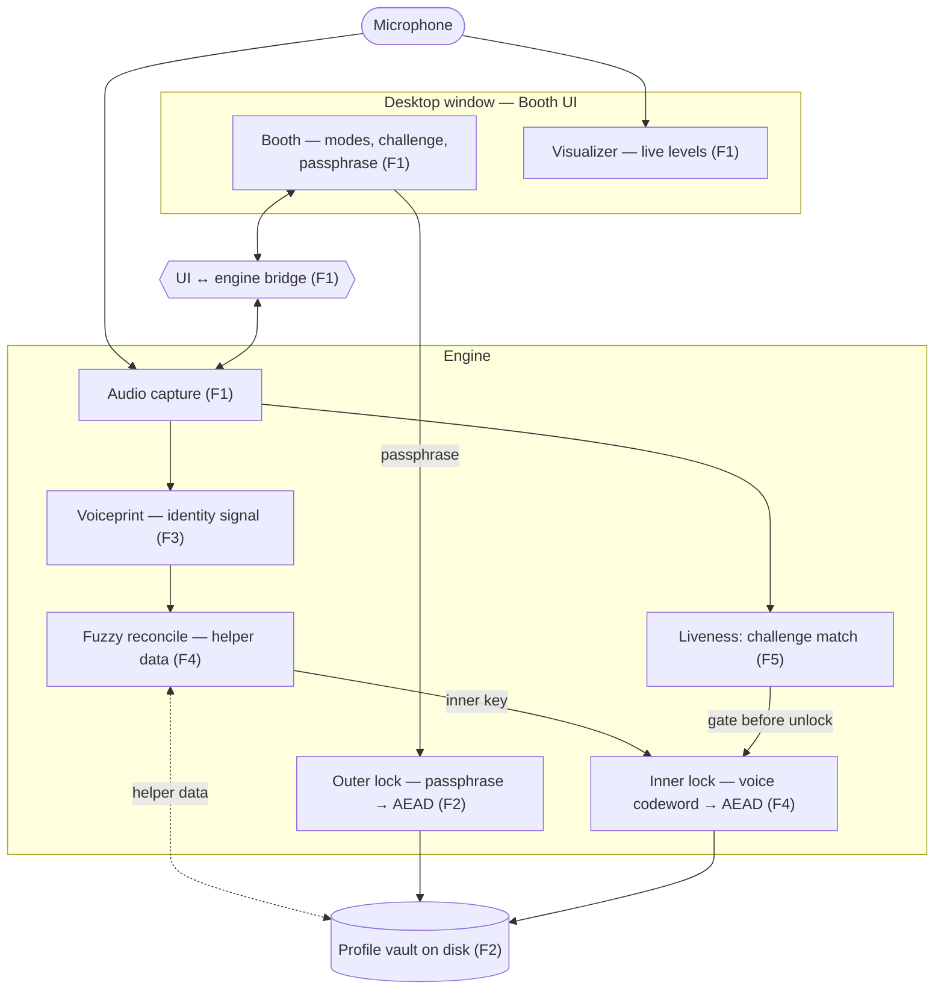

# Roadmap — VoiceLock (voice biometric profile vault)

Produced by the `design` skill. The durable, above-spec plan: what we're building
and in what order. Each feature below becomes its own `/spec` when you reach it.

## The idea

A local, offline learning project with a full end-to-end demo: enroll with name,
passphrase, and voice into an **encrypted profile vault**, then unlock only when
**both** passphrase and voice succeed — plus a fresh spoken challenge so a
recording can't cheat. Success signal: the real user gets in; wrong passphrase,
wrong voice, and replay all fail visibly.

## Intent & honest framing

Learning-first, demo-complete — not a shippable security product. Speaker match
and challenge-response liveness are in scope. Strong deepfake / live-clone
resistance is explicitly out; optional weak “robotic/flat” heuristics may come
later and must never be labeled as proof.

## Approach

**Approach B — two stacked locks** (an encrypted box inside an encrypted box).
The **outer** lock's key comes from the passphrase; the **inner** lock's key
comes from the voice (via a fuzzy reconciling step so today's slightly different
voice still yields the same codeword). Unlock peels both, so each impostor class
fails an independent factor. Chosen over “voice as a gate only” (voice wouldn't
truly seal the bytes) and over a single combined key (failures blur together).

Locked for all features (libraries chosen later via intake / TECH-PICK):

- One local, offline desktop app — no cloud, no network at runtime.
- Always both factors at unlock (passphrase + voice + live challenge).
- Voice identity = speaker match (embedding / voiceprint distance), not
  deepfake detection.
- Liveness for the full demo = random-prompt challenge-response (defeats replay).

## Architecture (intended)

Boxes = components, arrows = data flow. Tagged with the feature (F1–F6) that
builds them. High-level on purpose — how it connects, not how it's coded.

## Features (vertical slices, in build order)

Each is a thin end-to-end slice, demoable on its own. The full success arc
becomes reachable at **F5**. F6 makes the demo reliable and presentable.

- [ ] **F1 — The recording booth** · blocked-by: none
  App window: press to record, live visualizer reacts, audio captures and plays back.
  *Demo:* speak → visualizer moves → captured audio plays back. (No auth yet.)

- [ ] **F2 — Passphrase-only vault (outer lock)** · blocked-by: F1
  Enroll name + passphrase (+ a recording placeholder as needed); passphrase
  derives the outer key and seals a profile vault on disk. Unlock with passphrase.
  *Demo:* enroll → on-disk file is sealed → right passphrase opens → **wrong
  passphrase REJECT**.

- [ ] **F3 — Voiceprint on screen** · blocked-by: F1
  Compute the voiceprint and show match distance live vs a stored sample — not
  wired into the lock yet.
  *Demo:* same person → close / accept-colored; different person → far / reject-colored.

- [ ] **F4 — Voice as the inner lock (stacked)** · blocked-by: F2, F3
  Fuzzy-reconcile the voiceprint into a stable inner key; wrap the outer-sealed
  box inside the voice lock. Unlock needs **both**.
  *Demo:* right voice + passphrase → in; wrong passphrase → REJECT (outer);
  **different person's voice → REJECT** (inner).

- [ ] **F5 — Challenge-response liveness** · blocked-by: F4
  Each unlock shows a fresh random prompt; spoken audio must match it.
  *Demo:* **replay a recording → REJECT**. Full enroll → auth → three-impostor
  arc is now reachable.

- [ ] **F6 — Demo reliability** · blocked-by: F4
  Enrollment-quality gate, visible tolerance knob, clear per-rejection reason
  (wrong passphrase / voice / liveness).
  *Demo:* bad enrollment refused; dial tolerance; each reject names its cause.

### Parked (not in the must-build path)

- **F7 — Weak robotic/flat heuristic** · blocked-by: F5
  Optional exploration only; never claimed as deepfake-proof. Revisit after F6
  if you still want it.

## Out of scope

- Not a real security product — no FAR/FRR guarantees, no certification.
- No claim of stopping real-time voice cloning / deepfakes.
- No cloud, network, multi-device sync, or online accounts.
- No account recovery — lose passphrase or voice match → vault stays sealed.
- No mobile or browser product; no multi-user/admin management.
- No hardening against host malware, memory forensics, or side channels.
- Strong anti-deepfake models / eval pipelines (see parked F7 for a weak heuristic only).
