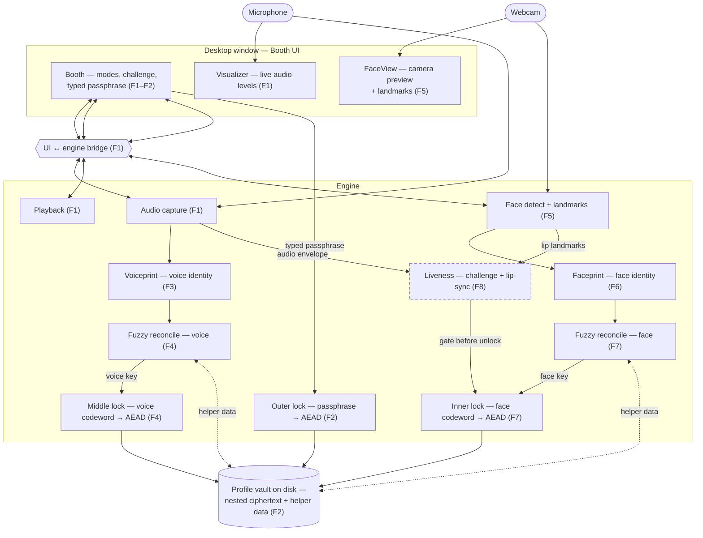

# Roadmap — VoiceLock (multi-factor biometric profile vault)

Produced by the `design` skill. The durable, above-spec plan: what we're building
and in what order. Each feature below becomes its own `/spec` when you reach it.

> **Name note:** "VoiceLock" is now a misnomer — the product uses voice **and**
> face **and** lip-liveness. The codename / package (`voicelock`, `uv run
> voicelock`, `~/.voicelock/`) is kept for now to avoid churn; a rename is an
> open nice-to-have (see Out of scope).

## The idea

A local, offline learning project with a full end-to-end demo. Enroll with a
name, a typed passphrase, your **voice**, and your **face**. To unlock, you type
the passphrase and then — in **one webcam+mic recording** — speak a random
challenge phrase to the camera. That single clip proves three things at once:
your voice matches (it's you), your face matches (it's you), and your lips move
in time with the words (you're a real, live person speaking right now, not a
photo or a replayed clip). Success signal: the real user gets in; a wrong
passphrase, a wrong voice, a wrong face, and a replay each fail **visibly and
distinctly**.

In the user's words: *"a video recording of your face while you talk that
verifies both [voice and face] — and on top of that verifies the person in the
video is moving their lips, to confirm they're an actual [live] person."*

## Intent & honest framing

Learning-first, demo-complete — **not** a shippable security product. In scope:
speaker match (voice embedding distance), face match (face embedding distance),
and challenge-response liveness via **audio-visual lip-sync**. Explicitly out:
strong deepfake / live-clone resistance. Lip-sync liveness defeats *simple*
replay — an audio-only clip, a still photo, a silent face video — but a
sophisticated video where lips already match the audio is **not** claimed to be
stopped. Any weak "robotic/flat" heuristics stay optional and are never labeled
as proof.

## Approach

**Approach B′ — three stacked locks** (an evolution of the original two-lock
Approach B; see `adr/0002-three-nested-locks.md`). An encrypted box inside an
encrypted box inside an encrypted box:

- **Outer lock** — key from the **typed passphrase** (something you know). *(built, F2)*
- **Middle lock** — key from the **voiceprint** via fuzzy reconcile (how you sound).
- **Inner lock** — key from the **faceprint** via fuzzy reconcile (how you look).

Unlock peels all three, so each impostor class fails an **independent** factor and
the cause stays nameable. Chosen over fusing the two biometrics into one key
(which would blur which factor failed — the same reason the original design
rejected a single combined key) and over using face/voice as mere match-gates
(which wouldn't cryptographically seal the bytes).

Locked for all features (specific libraries chosen later via TECH-PICK):

- One local, offline desktop app — no cloud, no network at runtime.
- Always **all factors** at unlock: passphrase + voice + face + live lip-sync challenge.
- Identity = biometric **match** (embedding distance), for both voice and face —
  not deepfake detection.
- Liveness for the full demo = challenge-response with **audio-visual lip-sync**
  (defeats simple replay).
- The typed passphrase is the one **exact secret**; voice, face, and challenge
  are fuzzy-matched and are **not** secrets.

## Architecture (intended)

Boxes = components, arrows = data flow. Tagged with the feature (F1–F9) that
builds them. Solid = built; dashed = planned. High-level on purpose.

## Features (vertical slices, in build order)

Each is a thin end-to-end slice, demoable on its own. Build order is **Order A**:
voice becomes a complete working lock first, then face, then liveness, then
polish. `blocked-by` names hard dependencies; the list order is the chosen build
sequence. The full success arc (all impostor classes) becomes reachable at
**F8**; **F9** makes the demo reliable and presentable.

- [x] **F1 — The recording booth** · blocked-by: none
  App window: press to record, live visualizer reacts, audio captures and plays back.
  *Demo:* speak → visualizer moves → captured audio plays back. (No auth yet.)

- [x] **F2 — Passphrase-only vault (outer lock)** · blocked-by: F1
  Enroll name + typed passphrase; passphrase derives the outer key and seals a
  profile vault on disk. Unlock with the passphrase.
  *Demo:* enroll → on-disk file is sealed → right passphrase opens → **wrong
  passphrase REJECT**.

- [x] **F3 — Voiceprint on screen** · blocked-by: F1 · **DONE 2026-07-23 (Mode 3)**
  Compute the voiceprint and show live match distance vs a stored sample — not
  wired into the lock yet.
  *Demo:* same person → close / accept-colored; different person → far / reject-colored.
  Built: vendored ECAPA (offline), `voiceprint.py` engine, Booth 3-band meter +
  Set reference + Reset (amendment). Human manual demo attested.

- [x] **F4 — Voice as the middle lock (stacked)** · blocked-by: F2, F3 · **DONE 2026-07-26 (Mode 3)**
  Fuzzy-reconcile the voiceprint into a stable key; wrap the outer-sealed box
  inside the voice lock. Unlock needs passphrase **and** voice.
  *Demo:* right voice + passphrase → in; wrong passphrase → REJECT (outer);
  **different person's voice → REJECT** (middle).

- [x] **F4.5 — Capture callback + test-harness hygiene** · blocked-by: F4 · **DONE 2026-07-26 (Mode 3)**
  Inserted 2026-07-26 (human decision) — not an original design feature, but a
  deliberate pause before F5. Fix the PortAudio callback self-deadlock on the
  30 s auto-stop path, make `FakeStream` deliver frames through the real
  callback so that path is actually covered, and declare the undeclared
  `soundfile` dependency. Sourced from the 2026-07-26 calibration run
  (`.out-of-scope/2026-07-26-calibration-findings.md`, items 1 and 2).
  *Why before F5:* F5 adds a camera stream with its own frame callback and
  would copy today's fake-stream pattern — one that never invokes the callback
  it is handed. Fix the pattern before it is inherited.
  *Demo:* a 30 s recording auto-stops cleanly instead of hanging; the callback
  path has tests.
  Built: `_on_audio` raises `sd.CallbackStop` instead of tearing down its own
  stream (no new state, no new flag); `FakeStream` delivers 2-D frames through
  the real callback and trips a `BaseException` wire on re-entrant teardown;
  `soundfile` declared. 3 tasks, `rejects: 0` on every one. Human attested the
  31-second live Booth check. **Task 2's fake-stream shape is the pattern F5's
  camera fake is meant to inherit.**

- [x] **F5 — Camera booth** · blocked-by: F1, F4.5 · **DONE 2026-07-26 (Mode 3)**
  Add a live webcam feed to the Booth with face detection + facial landmarks
  drawn on the preview. The visual analog of F1; prefactor for all face work.
  *Demo:* your face appears in the preview → a box/landmarks track it live.
  Built: `mediapipe` + `opencv-contrib-python` (human-approved TECH-PICK, with
  `numpy`/`torch` provably unmoved so F3/F4's cutoffs hold); the Face Landmarker
  bundle vendored offline beside `models/ecapa/`; `facedetect.py` doing the
  per-frame composite (detect on the full frame → ellipse + lip contour →
  centre-crop → **flip last**, so no landmark coordinate is ever mirrored) and
  the camera lifecycle (own daemon thread, halt→join→release, drop-don't-queue);
  the Booth `` in the existing 172 px disk. **All 478 landmarks are
  returned** though only a subset is drawn — F6/F7/F8 consume them.
  Engine throughput **10.3 ms/frame** against a 33 ms budget, so `TARGET_FPS`
  stayed at 30 on evidence. 7 tasks, `rejects: 1` on Tasks 5 and 7, 0 elsewhere.
  Human attested the live demo. Architecture recorded in
  `adr/0004-python-owns-the-camera.md`.
  **Two licence escalations fired as designed:** the model bundle cleared
  (Apache-2.0, established from Google's three model cards); the fixture did
  **not** — MediaPipe's `portrait.jpg` is a White House press photograph, so it
  is **fetched, never committed** (`.gitignore`d), while its Apache-2.0 vendor
  reference IS committed. **F6 inherits that arrangement** as well as the
  two-faces gap below.

- [x] **F5.5 — Voiceprint dead-surface hygiene** · blocked-by: F5 · **DONE 2026-07-26 (Mode 4)**
  Inserted 2026-07-26 (human decision) — not an original design feature, and the
  second hygiene pause of its kind. Remove surface in `voiceprint.py` that no
  caller and no test can reach (`_resample`, its two call sites, the stereo
  downmix, the `sample_rate` parameters on `embed`/`compare`), replace it with
  explicit `ValueError`s so bad audio is refused loudly instead of misread
  quietly, and rename the same-speaker test so it stops claiming to prove
  something these fixtures cannot. Sourced from calibration run 2
  (`.out-of-scope/2026-07-26-calibration-findings-run2.md`) — the same channel
  that produced F4.5.
  *Why before F6:* F6 reopens this exact module — it adds a faceprint that
  mirrors the voiceprint's shape and will read `voiceprint.py` as the pattern to
  copy. F4.5 exists because a bad pattern nearly propagated into F5; this is the
  same argument one feature later.
  *Carries a named blind spot:* "refuse unexpected input" is right only because
  `capture.py` pins the mic to one rate. **F6 must not copy it** — camera frames
  legitimately vary in resolution. The spec pins a Gate check that this
  justification stays written beside the code.
  *Demo:* none — no live surface. Deliberately the first feature with no manual
  check; the spec records why.
  Built: `load_wav` now raises `ValueError` naming the real sample rate and the
  real channel count instead of silently converting; `_resample`, both
  `sample_rate` parameters and the downmix branch are deleted; the same-speaker
  test is `test_compare_pipeline_runs_end_to_end` with the sub-window caveat in
  its docstring. 3 tasks, `rejects: 1` on Task 1 (a criterion-vs-spelling
  mismatch that found no defect), 0 elsewhere. Final Gate ran the full
  seven-command list plus both standing commands: **9/9 exit 0, 124 passed**
  (up from 122). No ADR earned — nothing here is hard to reverse.
  **The blind spot is mitigated and enforced:** the justification for refusing
  rather than converting is written beside the raises and §6's Gate command
  asserts it stays there. **F6 must not inherit that pattern for image data.**

- [x] **F6 — Faceprint on screen** · blocked-by: F5, F5.5 · **DONE 2026-07-27 (Mode 3)**
  Compute the faceprint (face embedding) and show live match distance vs a stored
  sample — not wired into the lock yet. The visual analog of F3.
  *Demo:* same face → close / accept-colored; different face → far / reject-colored.
  Built: vendored OpenCV SFace ONNX (Apache-2.0, licence established from
  opencv_zoo's own per-directory statement — stronger evidence than F5's
  model-card chain); `faceprint.py` (hand-built MediaPipe→YuNet 5-point
  alignment feeding `cv2.FaceRecognizerSF`, `ACCEPT_CUTOFF == REJECT_CUTOFF
  == 1.128` L2 per the 2026-07-27 decision, convert-never-refuse honored);
  three committed fixtures (two independent Douglass photographs + a CC0
  daguerreotype) with licence re-confirmed live at build time; Booth bridge
  (`set_face_reference`/`compare_face`/`reset_face_reference`, an additive
  `FaceEngine.last_frame`); Booth UI panel mirroring F3's voiceprint panel,
  polling `compare_face` on a 1s interval while recording, plus visible
  liveness-honesty copy. 5 tasks, `rejects: 1` (Task 3, an unexercised
  error branch). One mid-feature spec amendment (§5 cmd 4's resize was
  aspect-distorting and undetectable by design — fixed via a human-approved
  spec correction, not a code change) and one UI regression caught by the
  human's own manual smoke test (a Booth layout clipping bug with zero Gate
  coverage — this repo's Gate cannot detect CSS/layout regressions).
  **Two constraints inherited from F5's spec (2026-07-26), both resolved:**
  (1) **The embedding is OpenCV's SFace** — vendored as F6's second model
  dir, exactly as anticipated. (2) **F6 needed TWO faces in its fixtures**
  — resolved by `research`: two independent Frederick Douglass photographs
  (different photographer, negative, and custodial chain — not a derived
  probe) plus the MET daguerreotype carried over from F5.

- [x] **F7 — Face as the inner lock (innermost)** · blocked-by: F4, F6 · **DONE 2026-07-28 (Mode 3)**
  Fuzzy-reconcile the faceprint into a stable key; wrap the voice-sealed box
  inside the face lock. Unlock now peels passphrase → voice → face.
  *Demo:* wrong passphrase / wrong voice / **wrong face** each REJECT distinctly.
  Built: `facelock.py` (new) — the same code-offset fuzzy commitment as F4's
  `middlelock.py`, reparameterized for SFace's 128-dim embedding;
  variable-length enrollment (≥1 embedding, so one Gate-test fixture and a
  live 3-frame burst share the same code path) and a measured
  `CORRECTION_RADIUS = 95` (n=1 genuine/n=2 impostor, disclosed as thinner
  evidence than F4's 200-commit measurement). `vault.py` bumped to **v3**,
  three nested AEAD layers (passphrase outer → voice middle → face inner),
  both v1 and v2 vaults refused by name. Booth bridge gained
  `enroll_face_take`/`reset_enroll_face_takes` (mirroring the F4 voice
  pair) and unlock's third layer (`auth_face`). Booth UI gained the
  enroll-face capture step and a third, visibly distinct reject chip. F6's
  diagnostic faceprint panel stayed completely untouched, exactly as F3's
  voiceprint panel survived F4. 3 tasks, `rejects: 1` on Task 2 (missing
  test coverage on new bridge surfaces — `no_face` edges and an
  unexercised `reset_enroll_face_takes()` — fixed same session), 0 on
  Tasks 1 and 3. Human attested the live 4-outcome demo, verbatim
  "everything worked perfect".
  **One plan-contradiction BLOCKED stop, same shape as F4 Task 3's
  precedent:** Task 2's declared `files:` line excluded `app.py`, but its
  done-criteria demanded a green full suite, and the vault signature
  change broke `app.py`'s only calls to it. Stopped per the universal
  `[Modes]` rule, human chose to merge Task 2 with the former standalone
  bridge task (former Task 4 renumbered Task 3; `memory/deviations.md`
  F7-T2). **This recurrence (F4 Task 3, now F7 Task 2) is now a
  `project.md` guardrail** — human-approved: `/plan` must grep for every
  in-repo caller of a function before splitting a signature change across
  two tasks.

- [x] **F8 — Lip-sync liveness (challenge-response)** · blocked-by: F7 ·
  **DONE 2026-07-29 (Mode 3)**
  Each unlock shows a fresh random phrase; in one webcam+mic capture the user
  speaks it. Verify the spoken words match the challenge, the voiceprint matches,
  the faceprint matches, **and** the lips move in sync with the audio.
  *Demo:* **replay a recording / hold up a photo / play audio at a muted video →
  REJECT.** Full enroll → auth → four-impostor arc is now reachable.
  Built: vendored Vosk small-en model (Apache-2.0) + `challenge.py`
  (hand-authored 12-phrase pool, grammar-constrained match); `lipsync.py`
  (lag-windowed cross-correlation of mouth-aperture vs audio envelope,
  `SYNC_THRESHOLD`/`LAG_WINDOW` dry-run measured); Booth bridge liveness
  gate (`new_challenge()`, `start_unlock_capture()`/`stop_unlock_capture()`,
  `_liveness_passes()` runs BEFORE any `vault_unlock()` call — ADR 0005);
  Booth UI (challenge display, fifth `auth_liveness` reject chip, plus a
  human-requested **Lock** button that resets the display without touching
  the vault). 4 tasks, `rejects: 1/1/0/0` — both REJECTs were
  Standards-axis (an unused exception class; an untested lag-search loop),
  fixed same session each time.
  **The required live demo (spec §5 cmd 4) found real bugs on its first
  run (2026-07-28/29), exactly the gap Q5/§6 disclosed in advance** — the
  automated Gate can prove the challenge-match reject path and the
  lip-sync scoring math, never either signal's real ACCEPT path. Three
  independent causes, diagnosed with temporary instrumentation and fixed
  same day: (1) real camera frames don't arrive on the fixed grid the
  audio envelope assumed, desyncing the correlation over a take's length
  — fixed by timestamping every retained mouth-aperture sample and
  resampling onto the envelope's real time grid; (2) `matches()` required
  an exact full-string match, but real Vosk decoding routinely glues on a
  stray word or repeats the phrase — relaxed to substring containment,
  still safe under the grammar-constrained decode; (3) the Record/Stop
  routing heuristic (passphrase-field focus) silently misrouted the
  session's first take — replaced with a deterministic rule (enroll panel
  open/closed). 229 tests passing (up from 186 at F7). Human attested the
  full live demo after the fix: unlock, wrong passphrase/voice/face, and
  liveness REJECT via two distinct methods (covering the mouth, plus a
  second). One `memory/deviations.md` entry at Task 4 (a plan-note
  precedent that didn't exist), whose resulting design is what the live
  demo then found unreliable and prompted fix (3) above — see that entry
  and `plan.md`'s Task 4 build notes for the full chain.
  **Parked to F9** (human-requested, not built): detect a covered/occluded
  mouth during capture and stop early, instead of only failing afterward
  as a generic liveness reject — infeasible today since MediaPipe's
  landmarks can't distinguish "occluded" from "just not moving."

- [ ] **F9 — Demo reliability** · blocked-by: F7
  Enrollment-quality gate (voice **and** face), visible tolerance knobs, clear
  per-rejection reason (wrong passphrase / voice / face / liveness).
  *Demo:* bad enrollment refused; dial tolerance; each reject names its cause.
  **Inherited from F5 Task 7's REJECT #1 (2026-07-26), recorded here so it
  survives handoff rewrites:** a **camera** error is surfaced through
  `_push_mic_error`, because `spec.md` (F5) §4 said to surface it "the way
  `_push_mic_error` does" and reusing the function was the shortest honest
  reading. Consequence: on a machine with no webcam the Booth shows
  "No camera available" under a **"LOCKED · MIC ERROR"** status, and since there
  is no `hideMicError` the banner **persists for the rest of the session** while
  the microphone works fine. Audio recording is unaffected (the transport
  buttons are re-enabled by `setRecording(true)`), so this is a labelling and
  stuck-state problem, not a functional one. F9 owns per-cause messaging and is
  where a distinct camera chip — and a way to clear it — belongs.
  **Parked from F8's live-demo checkpoint (2026-07-29, human-requested):**
  detect during the AV capture itself when the mouth/face isn't clearly
  visible (e.g. covered by a hand) and stop or warn early, instead of
  letting the whole take finish and only failing afterward as a generic
  `auth_liveness` reject. Not built at F8 because the underlying signal
  doesn't exist yet — MediaPipe's landmark output can't currently
  distinguish "mouth occluded" from "mouth just not moving," both read as
  a flat `mouth_aperture()` series; a real version would need a new signal
  (e.g. per-landmark detection confidence, not currently exposed by
  `facedetect.py`) and its own design pass, not a quick patch. Today's
  behavior (occluded mouth → liveness REJECT) is correct-by-design, not a
  bug — the ask is a better UX for reaching that same reject sooner.

### Parked (not in the must-build path)

- **F10 — Weak robotic/flat heuristic** · blocked-by: F8
  Optional exploration only; never claimed as deepfake-proof. Revisit after F9
  if you still want it.

- **F11 — Manage enrollment from inside the vault** · blocked-by: F7
  Once unlocked, let the user change the passphrase and re-enroll voice/face
  from inside their profile (edit/reset any of the three factors). Profile
  management — only meaningful after all three factors are real locks (post-F7),
  likely bundled with or after F9. Human-requested 2026-07-23; not yet specced,
  parked here so it isn't lost.

## Out of scope

- Not a real security product — no FAR/FRR guarantees, no certification.
- No claim of stopping real-time voice cloning or synced deepfake video.
- No cloud, network, multi-device sync, or online accounts.
- No account recovery — lose the passphrase, voice, or face match → vault stays sealed.
- No mobile or browser product; no multi-user/admin management.
- No hardening against host malware, memory forensics, or side channels.
- Strong anti-deepfake models / eval pipelines (see parked F10 for a weak heuristic only).
- **Product rename** away from "VoiceLock" — deferred nice-to-have; not built until a human decides the new name (would touch package, entry point, and vault path).
